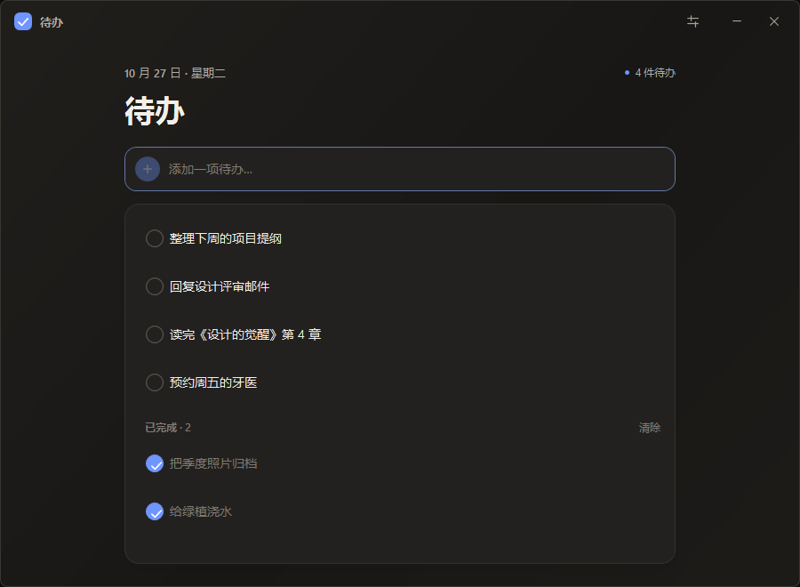

# 待办 · DaiBan

一款只做一件事的 Windows 11 桌面待办清单。原生 WPF 界面，无账号、不联网、没有多余的模块。

[**下载 Windows 版**](https://github.com/paulwatcegt-ui/to-do/releases/latest) · [查看源码](https://github.com/paulwatcegt-ui/to-do)

| 浅色 | 深色 |
| --- | --- |
|  |  |

## 功能

- 输入待办后按 `Enter` 添加，`Ctrl+N` 随时回到输入框。
- 点击左侧圆圈完成或恢复任务。
- 双击标题，或悬停后点击铅笔，进入行内编辑。
- 删除和批量清除已完成任务都支持撤销。
- 自动保存在本机；不需要登录，不发起网络请求。
- 设置中可切换**跟随系统 / 浅色 / 深色**，主题即时生效。
- 设置中可**自定义任务数据的保存文件夹**。
- 窗口支持拖动、边缘调整大小，右上角提供设置、最小化和关闭。
- 已完成任务位于列表下方；界面保持单列、低干扰。

## 安装

需要 Windows 11。依赖系统自带的 Windows PowerShell 5.1 和 WPF，不需要安装额外运行库。

### 从发布包安装

1. 从 [Releases](https://github.com/paulwatcegt-ui/to-do/releases/latest) 下载 `DaiBan-v1.1.0.zip`，解压到任意目录。
2. 在该目录打开 PowerShell，运行：

```powershell
powershell.exe -NoProfile -ExecutionPolicy Bypass -File .\install.ps1
```

3. 按 `Win` 键，搜索「待办」即可启动。

安装只会在当前用户范围内进行：

- 程序复制到 `%LOCALAPPDATA%\Programs\DaiBan`
- 在开始菜单创建「待办」快捷方式
- 不写注册表，不设置开机自启，不需要管理员权限

如需桌面快捷方式：

```powershell
powershell.exe -NoProfile -ExecutionPolicy Bypass -File .\install.ps1 -DesktopShortcut
```

### 从源码直接运行

```powershell
powershell.exe -NoProfile -STA -ExecutionPolicy Bypass -File .\app\DaiBan.ps1
```

### 卸载

```powershell
powershell.exe -NoProfile -ExecutionPolicy Bypass -File "$env:LOCALAPPDATA\Programs\DaiBan\uninstall.ps1"
```

默认保留设置与数据。连同默认位置的数据一起删除：

```powershell
powershell.exe -NoProfile -ExecutionPolicy Bypass -File "$env:LOCALAPPDATA\Programs\DaiBan\uninstall.ps1" -RemoveData
```

若使用过自定义保存位置，该位置的数据文件不会被卸载脚本删除。

## 设置

点击标题栏的设置图标，或按 `Ctrl+,` 打开设置。

- **外观**：跟随系统、浅色、深色。选择会立即保存。
- **保存位置**：选择任意可写文件夹。应用会把当前清单写入该文件夹的 `todos.json`；如果目标已有待办文件，会先备份再覆盖。原有位置的数据文件不会被自动删除。
- 恢复默认位置会把当前清单写回 `%APPDATA%\DaiBan`，并同样保护已有文件。
- 设置文件自身固定在 `%APPDATA%\DaiBan\settings.json`，这样即使更改任务目录，应用下次仍能找到设置。

## 数据

默认任务文件：

```text
%APPDATA%\DaiBan\todos.json
```

设置文件：

```text
%APPDATA%\DaiBan\settings.json
```

数据只保存在本机。应用没有遥测、网络请求或账号系统。自动更新目前不包含在内。

## 快捷键

| 操作 | 快捷键 |
| --- | --- |
| 聚焦添加框 | `Ctrl+N` |
| 打开/关闭设置 | `Ctrl+,` |
| 添加 | `Enter` |
| 保存行内编辑 | `Enter` |
| 取消编辑 / 关闭设置 / 关闭提示条 | `Esc` |

## 开发

没有编译步骤。界面 XAML 在运行时由 WPF 加载，逻辑与事件都在纯 PowerShell 中。当前架构之所以不是单个 exe，是因为当前 Windows 11 的智能应用控制会拦截未签名 exe；应用使用系统签名组件承载 WPF，无需关闭系统安全设置。

```text
app/
  DaiBan.ps1          应用逻辑、WPF 启动、原生拾取器、设置
  ui.xaml             窗口、样式与设置面板
  themes/light.xaml   浅色资源
  themes/dark.xaml    深色资源
  app.ico             应用图标
install.ps1           当前用户安装
uninstall.ps1         当前用户卸载
scripts/package.ps1   Release 打包
scripts/sign.ps1      Authenticode 签名辅助脚本
tests/validate.ps1    语法、XAML、主题键和文件校验
```

验证：

```powershell
powershell.exe -NoProfile -STA -ExecutionPolicy Bypass -File .\tests\validate.ps1
```

打包：

```powershell
powershell.exe -NoProfile -ExecutionPolicy Bypass -File .\scripts\package.ps1
```

签名前的准备、所需证书和 GitHub Secrets 配置见 [docs/SIGNING.md](docs/SIGNING.md)。

更多设计与实现约束见 [docs/ARCHITECTURE.md](docs/ARCHITECTURE.md)。

## 已知限制

- 仅针对 Windows 11 优化；其他 Windows 版本没有专门测试。
- 界面语言目前只有简体中文。
- 为了让启用智能应用控制的机器也能运行，应用由 Windows PowerShell 承载。任务管理器中的进程名会显示为 Windows PowerShell，而不是独立的 DaiBan 进程。
- 当前发布可以使用 Authenticode 对 PowerShell 脚本签名，但这不会自动让所有智能应用控制环境信任一个本地脚本项目。若未来需要发布独立的原生 exe，需要额外的原生构建和受信任的代码签名证书。
- 无云同步、无多设备、无提醒通知。这是刻意的范围限制。

## 参与

欢迎提出聚焦于“极简本地待办”这一范围的改动。请先阅读 [CONTRIBUTING.md](CONTRIBUTING.md)。

## License

[MIT](LICENSE)

---

## English quick start

DaiBan is a local-first, minimalist todo app for Windows 11. It uses WPF hosted by the signed Windows PowerShell runtime, requires no external dependencies, and never connects to the network.

- Themes: follow system, light, dark.
- User-selectable data directory.
- Install for the current user:

```powershell
powershell.exe -NoProfile -ExecutionPolicy Bypass -File .\install.ps1
```

Launch it from the Start menu. See [docs/SIGNING.md](docs/SIGNING.md) for release signing and [CONTRIBUTING.md](CONTRIBUTING.md) for development.
